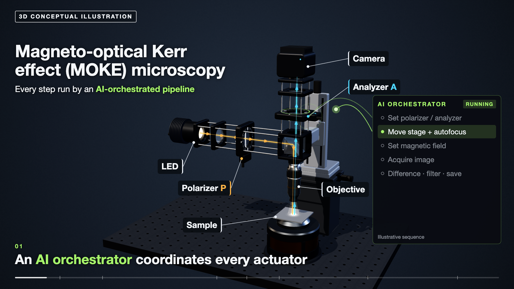

# AI-agent-driven physics experiments

**Kaito Tomabechi · M.S. student in Physics, [Nakatsuji–Sakai Laboratory](https://nakatsuji-lab.phys.s.u-tokyo.ac.jp/), The University of Tokyo**

**IPA MITOU IT 2026** ([selected as sole creator](https://www.ipa.go.jp/jinzai/mitou/it/2026/gaiyou-tk-3.html)) · **Google–UTokyo Quantum Fellow 2026** · **Live demonstration at the JST-Mirai site visit, 2026 (the only student presenter)** · **Research intern, Max Planck Institute for Solid State Research (Stuttgart, Germany)**

I automated a MOKE (magneto-optical Kerr effect) microscope and built the AI-agent platform that runs it. The same agents also run circuit design and testing and high-frequency electrical measurement: so far a camera, motorized polarizers, an XYZ stage, a magnet, a DC power supply, a pulse generator, a multimeter, an oscilloscope and an FPGA. Algorithmic pipelines control the instrument and acquire the data; resident LLM agents diagnose failures, repair the software and resume from saved progress. The results connect to analysis, reports and automated device layout.

**Three short videos:** [3D concept · 97 s, with sound](assets/moke-concept-v7.mp4) · [Real operation · 57 s, with music](assets/real-operation.mp4) ([captions](assets/real-operation-en.vtt)) · [Automated CAD output · 26 s, with music](assets/autocad-automation-momentum-v7.mp4)

**[Open the portfolio: kaito-tomabechi.github.io](https://kaito-tomabechi.github.io/)** · [Contact / request my CV](mailto:kaito-tomabechi501665@g.ecc.u-tokyo.ac.jp)

The concept video illustrates the system with original music and sound effects; its sequence, failure and code are illustrative. The real-operation video is edited from a screen recording of the real microscope at ×3–×8, with most of each acquisition cut; its 3D inset and field-step cut are illustrations. The CAD video is a real AutoCAD screen capture with a demonstration layout and edited playback speed.

## What I built

- **Instrument automation:** I added a motorized stage and polarizers to the laboratory's existing MOKE microscope, connected it to LabVIEW, and built the control pipeline and the bridge that lets AI agents operate it.
- **From placement to measurement:** image recognition establishes coordinates, locates devices, aligns and focuses them for batch acquisition.
- **Recovery without human intervention:** on 18 September 2026, the resident LLM diagnosed a save failure, repaired the workflow and resumed acquisition. Nineteen completed cells stayed unchanged; the interrupted cell produced its five measurement images.
- **From measurement to interpretation and design:** Development, Experiment and Analysis agents connect acquisition, transfer, analysis, reports and automated CAD layout.

**Production thin-film result: 40 hours of manual work → 2 minutes of operator input + 3 hours of unattended measurement.** Operator time and machine time are counted separately.

**In routine use: 315,000+ images acquired automatically (March–October 2026), 124 devices measured on 14 samples, 1,000+ hours of logged automated runs, and a longest single unattended run of 66 hours.** Detailed records from part of the runs document four agent repairs during physical runs (September–October 2026). The platform is now a core part of the group's research infrastructure, used daily by five members; its exhaustive screening has produced several qualitatively new findings (paper in preparation), and the university hired me as a technical assistant for this work in March 2026.

## Inspect the work

| Evidence | What to look for |
|---|---|
| [Autofocus from one run](assets/focus-score.png) | Eleven recorded positions; the three marked positions match original device images on the page |
| [Film orientation regions](index.html#results) | Optically inferred crystal orientation of thin-film regions, from the automated analysis |
| [Automated CAD output](assets/autocad-automation-momentum-v7.mp4) | Devices and electrodes generated across 60 cells from one reusable design |

[Evidence and scope](docs/evidence.md) · [Media provenance](docs/media.md)

The laboratory built the original MOKE microscope. Everything else here is my work: the hardware automation, the LabVIEW connection, all software (architecture, recognition and coordinate cache, autofocus, batch control, supervision and recovery, data transfer, analysis panels, automated reports and CAD layout), and every measurement and analysis shown.

**2026 IPA MITOU selection** ([official announcement](https://www.ipa.go.jp/jinzai/mitou/it/2026/koubokekka.html)) · **MERIT Camp Excellent Poster Award** · Live demonstration at an **August 2026 JST-Mirai site visit**, as the only student presenter.

Production systems and code remain private, including instrument adapters, prompts, safety implementation and research datasets. No open-source license is granted. Selected presentation media are not a release of the underlying datasets.

Next, I want to bring agentic experiments to quantum materials, where new behaviour often hides in a narrow window of samples and conditions, and to search that window far more thoroughly than a person can. I am applying to PhD programs for Fall 2027. [Contact me](mailto:kaito-tomabechi501665@g.ecc.u-tokyo.ac.jp).
