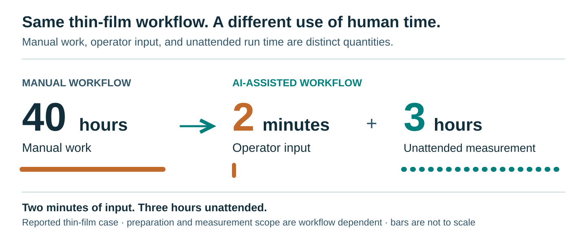

# Evidence and scope

## What is directly shown

- An eleven-position autofocus score curve and three corresponding original device images.
- Twenty-one processed orientation estimates from separate thin-film regions.
- A real AutoCAD screen capture of automated device-and-electrode layout across 60 cells, using a demonstration layout.
- Measurement-side repair and resume cases reconstructed from archived records.
- A 97-second 3D illustration of AI orchestration, an illustrative repair sequence and two other use cases of the same AI layer.
- A 57-second edited video: a screen recording of two example devices from one run, focused and imaged by software including MOKE images (×3–×8; most of each acquisition and the time between the devices cut), then a separate archived autofocus run, a field-step illustration and results from other runs.

The recordings and figures come from separate runs. None is presented as one uninterrupted run. The material identity and selected experimental details are withheld.

## Impact

The author reconfirmed the production thin-film comparison: 40 hours of manual work became 2 minutes of operator input plus 3 hours of unattended operation. The figure covers acquiring and saving the selected image series. It is specific to that workflow; it is not a 1200× end-to-end speedup and does not include sample setup.

The platform is now a core part of the group's research infrastructure, used daily by five members. The author reports that its exhaustive screening has produced several qualitatively new findings; a paper is in preparation. The university hired the author as a technical assistant for this work in March 2026. The fellowships, selections and awards listed on the page, other than the Qiskit Fall Fest prize, were given for this work.

Cumulative use, from the laboratory's run records (checked 29 October 2026):
- **Images:** 315,000+ instrument images saved by automated acquisition, March–October 2026. Copies on two drives are counted once; derived analysis outputs and backups are excluded. The sessions before late May have no run log; the author confirms they were automated.
- **Hours:** 1,000+ hours of logged automated runs, May–October 2026, summed from start to end of each logged run. Runs before late May were not logged and are not counted.
- **Devices:** 124 distinct device positions on 14 samples with at least one automatically acquired image. Film-screening regions are counted separately.
- **Longest single run:** 65 h 54 min (18–20 July 2026), executed by the measurement pipeline. Its log contains no pause, resume, stop or operator event.

## Contribution and recognition

The laboratory built the original MOKE microscope. Everything else on the page is the author's work:

- adding a motorized stage and polarizers to the existing microscope;
- the LabVIEW connection, the PC control pipeline and the bridge that lets AI agents operate it;
- image-based targeting, autofocus and batch execution;
- transfer and waiting-time coordination;
- analysis panels, visualization and report generation;
- automated CAD layout;
- every measurement and analysis shown.

The IPA 2026 selection is publicly listed in the [official announcement](https://www.ipa.go.jp/jinzai/mitou/it/2026/koubokekka.html). The MERIT Excellent Poster Award is recorded in the author's CV. The August JST-Mirai site-visit demonstration is documented in the corresponding presentation materials; the author was the only student presenter. It is a demonstration, not an award or an institutional endorsement.

## What remains private

Production code, prompts, adapters, safety implementation, raw datasets and research-specific CAD layouts remain private. The 3D illustration is labelled as such on the page; the recovery figure is drawn from the run records.

## Recovery

The author confirms repeated successful interventions by a resident measurement-side LLM. Representative records were checked on 28 October 2026.

**September 18, multi-cell screening.**

What happened:
- A Windows preview-image write error interrupted a device after its reference image.
- The observing agent diagnosed the problem, stopped through the normal interface and confirmed the safe stop.
- It repaired preview-save handling and partial-preparation resumption, then resumed acquisition at about 2:55 a.m. JST. The records show no operator action during the repair, and the author confirms that no messages were sent to the agent.

What the records show:
- The first 95 accepted capture records (19 completed cells) are identical in the interrupted and final records.
- All five images acquired at the resumed cell match their registered hashes. The comparison counts accepted images and excludes the incomplete preparation image.
- The error occurred at 02:42:51 and the five images were complete at 02:59:13, an interval of 16 minutes 22 seconds. This interval includes repair and reacquisition.
- The final campaign records contain 48 completed cells and 240 accepted captures. Later interventions are recorded separately.

**October 27, long acquisition.** A readback failure interrupted acquisition. The observing agent repaired the restart logic, resumed through the normal interface and completed the pending conditions without redoing finished work.

Only part of the September–October 2026 runs were recorded in detail. Those records document four repairs that meet a strict definition: the agent diagnosed a failure during a physical run, deployed a code fix, resumed through the normal interface and the run completed (17 September, 18 September twice, 27 October): an autofocus step blocked at a repeat boundary, data saved without its numeric values (the agent stopped the run itself), the preview-image write failure described above, and a readback gap followed by a stuck restart. These cases show LLM-mediated diagnosis, software correction and resumption, beyond fixed-supervisor retries. They do not guarantee recovery from every failure. The portfolio does not expose actual code patches, internal paths, material identities or prompts. The 3D concept uses an invented illustrative patch, not the actual September correction.

## Focus

The selected example is one archived autofocus run:
- Its saved result links eleven positions, from 18 µm below to 6 µm above the selected position, to their frames and scores.
- Three original photographs show the same device at −6 µm, the selected position and +6 µm. The chart marks these three positions.
- The three JPEGs were copied without image processing and match the source SHA256 hashes.
- The selected score aggregates three confirmation frames; each other position has one frame.
- Relative positions are recorded stage values, not an independently calibrated absolute focus accuracy.

## Coordination

The Development, Experiment and Analysis agent roles and their feedback routes are the author's system-level description. Separate records illustrate different parts of the architecture:
- An archived campaign confirms the transfer of 216/216 measurement images and the generation of an HTML gallery after acquisition.
- A separate scheduled Film Analysis run repaired an output-path issue, reran and saved six hash-verified artifacts plus an updated report.
- The CAD layout step is shown separately with demonstration inputs.

These records are not one joined trace proving every feedback route in a single unattended campaign.
